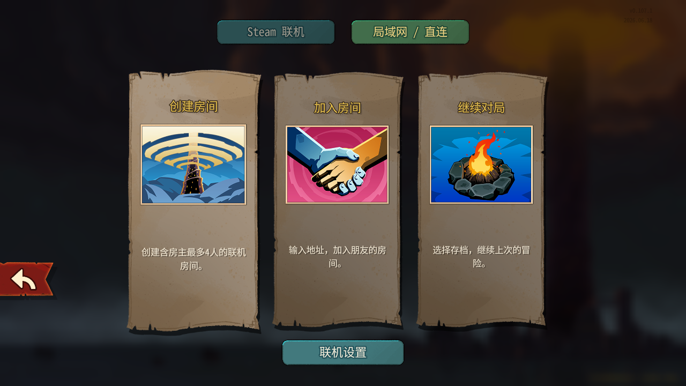
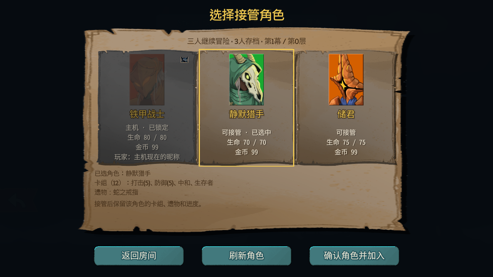
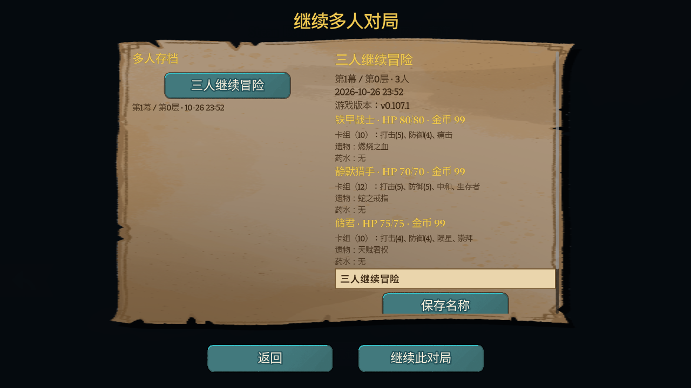
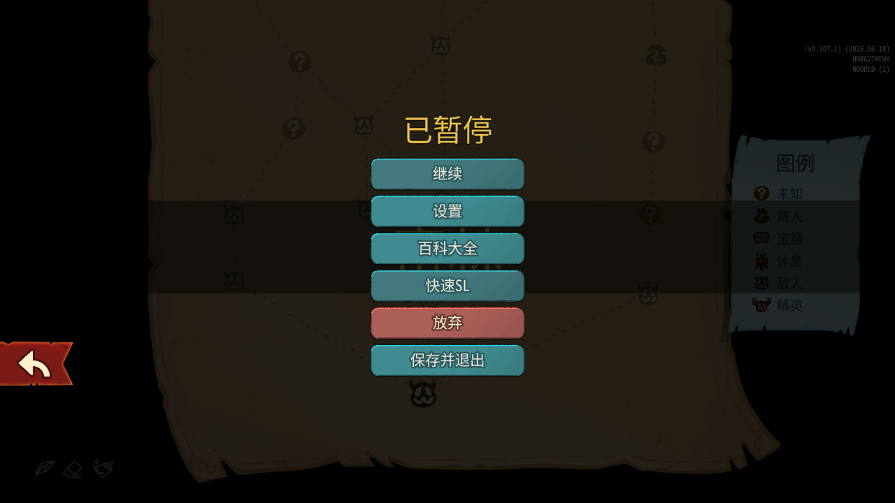
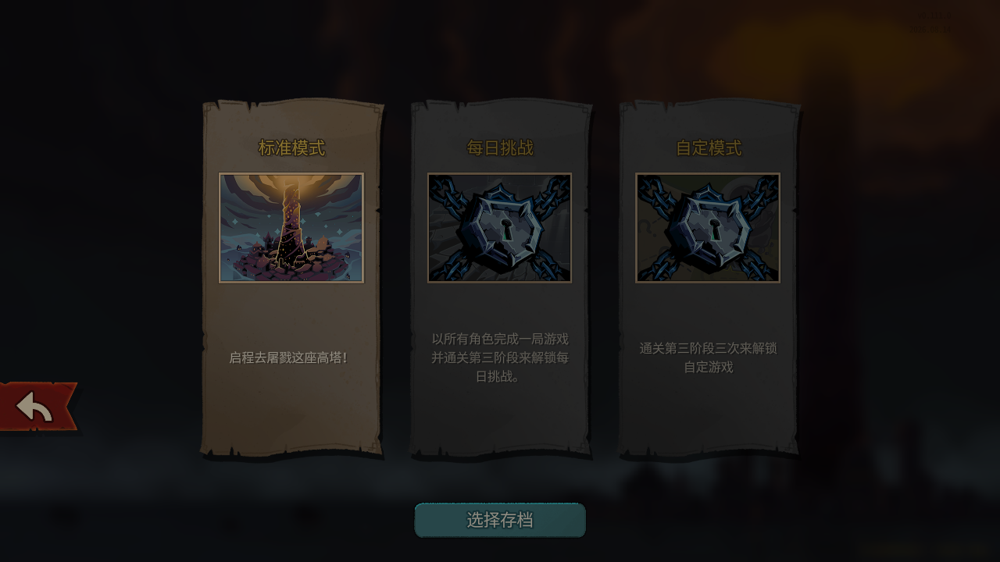
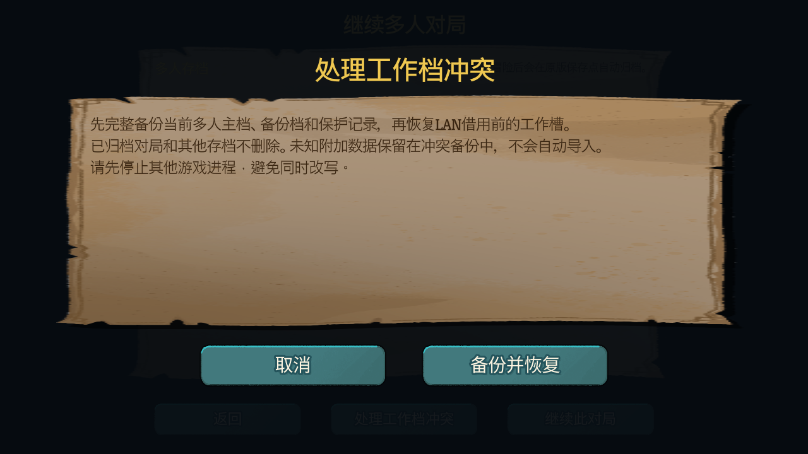

# STS2 LAN Co-op · 局域网四人联机（正版 / 离线 / 安卓）

面向《杀戮尖塔 2》（Slay the Spire 2）的**局域网 / 地址直连四人合作 Mod**。让最多四名玩家通过实体局域网、虚拟组网（Radmin）或 UDP 穿透（樱花）进入同一个合作房间。


> English: a LAN / direct-IP co-op mod for *Slay the Spire 2*, **one DLL for both v0.107.1 and v0.111.0**. Native-style Steam/LAN menus, 4-player rooms, named multiplayer saves, saved-role takeover cards, pause-menu quick reload, solo reload and multi-save library, host mod synchronization, optional shared unlocks, and explicit working-save conflict recovery. All players in a room must run the same game and mod versions. Steam, offline (non-Steam) builds and Android guests are supported. GPL-3.0.

## 安装（下载即用）

1. **退出游戏**，备份整个游戏用户存档目录。建议先使用独立测试配置。
2. 从本页 [Releases](https://github.com/murongyueyu/sts2-lan-coop/releases) 下载，或点右上角绿色 `Code` → `Download ZIP`。
3. 解压后，把 `sts2_lan_coop` **整个文件夹**放进游戏的 `mods` 目录：
   ```
   你的游戏目录/mods/sts2_lan_coop/
   ├── sts2_lan_coop.dll       程序本体
   ├── sts2_lan_coop.json      清单
   ├── Apply-ModSync.ps1       模组同步的本地应用助手（勿删）
   ├── Organize-Workshop.ps1   工坊数字目录整理/恢复助手（Windows）
   ├── LICENSE
   └── README.md               操作说明
   ```
4. **禁用外部 QuickSL**（本版已内置快速 SL，两套同时开会冲突），然后**完整重启**游戏。
5. 进入多人菜单，点右上角「局域网 / 直连 · 4 人」。

> ⚠️ 所有参与者必须使用**同一个** Mod 版本与**同一个**游戏版本。旧版本、手机内置 LAN 无法加入本版房间。

建房、续局、换人、快速 SL 和模组同步的完整操作说明见 [sts2_lan_coop/README.md](sts2_lan_coop/README.md)。

## 用途

《杀戮尖塔 2》的多人模式依赖 Steam 网络。当朋友不在同一个 Steam 环境、想直接走局域网、或者需要跨网络联机时，原版没有可用的连接入口。

本项目补上这个入口：在游戏内提供「局域网 / 直连 · 4 人」面板，复用原版 ENet/UDP 的建房与加入流程，让 2–4 名玩家在同一个可达地址上开一局合作。

| 问题 | 本项目提供的做法 |
| --- | --- |
| 原版只有 Steam 联机 | IPv4 / 域名直连，可配置 UDP 监听端口、复制网卡与樱花外部地址、记住最近成功连接 |
| 想在手机上和朋友一起玩 | **Android（Sts2MobileLauncher）客机联机**：查看房间、认领角色并加入 Windows 房主，参与/申请全员快速 SL，并比较/下载主机模组包后手动导入 |
| 一局结束就得重开 | 每局独立命名存档 + 「继续多人对局」列表，可重命名后接着打 |
| 朋友退坑后存档就废了 | 客机可**接替**离线朋友的角色，或彼此**互换**；进度完整保留，不需要原朋友在线 |
| 打崩了要全员重开房间 | 「快速 SL · 全员重载」：暂停菜单一键或 `Ctrl+F8`，**保留连接和当前角色**回到最近保存点 |
| 各人装的模组版本不一样，进不去房间 | **主机模组同步**：比对主机与客机的模组清单，按主机版本直传同端口版本包，退出后由助手事务式安装并可回滚 |
| 装了 Ritsu 系模组后开局黑屏/卡选角 | **Ritsu 扩展网络互通**：保留第三方扩展网络帧与接收顺序，保护旧大厅回调；不改第三方 DLL |
| 玩模组版时原版解锁进度不生效 | **共用解锁**（可选、默认关闭）：加载模组进度时合并原版解锁，保存时导出新增解锁；对局、战绩与成就记录仍然各自独立 |
| 不知道队友是谁 | 昵称随会话同步，显示当前实际操作者 |
| 游戏更新后旧 Mod 失效 | **同一份 DLL 同时支持 v0.107.1 与 v0.111.0**，不用为两个游戏版本准备两份安装包；但同一房间内仍须使用相同游戏版本 |
| 想要原版风格的联机入口 | **Steam 联机 / 局域网 · 直连**并列页签；LAN 页提供创建房间、加入房间、继续对局与联机设置 |
| 旧存档客机角色不好接 | 独立**角色接管卡片页**：主机锁定、已占用禁选、金色选中与卡组/遗物摘要，确认前复查并由主机最终预留 |
| 单人也要快速SL和多存档 | 单人普通冒险独立**快速SL**、**单人多存档**与按局删除；每日/自定义模式保持原版 |
| 保存后工作档报冲突 | 扩展追加写入不再误报；冲突时「处理工作档冲突」**先完整备份主档、backup 与租约，再恢复**，未知数据只留备份 |
| 改 Mod 就绕开校验 | 保留原版版本、玩法 Mod 与模型哈希检查，不静默忽略差异 |

## 截图













## 当前状态

**alpha 开发版；Android 客机联机已支持并开放，跨网络整局与不同启动器版本仍以实际反馈为准。**

- **0.8.0-alpha.3**：原版风格 Steam/LAN 并列菜单、旧存档角色接管卡片、暂停菜单快速SL、单人快速SL与单人多存档、按局删除和终局清理；本版修复扩展保存后的工作档误报，新增显式确认的冲突恢复。核心77项、JMC/Ritsu 两进程78项、渲染UI27项通过，双版本 API 各173引用0缺失。

- 已在本机以真实引擎 + 四个独立游戏进程验证到首个 MapRoom，并覆盖满员拒绝、端口占用、取消、准备同步、存档与快速 SL。
- 主机模组同步已实现同端口版本包传输、完整文件校验、进度/取消/断点缓存、退出后事务式应用与恢复；**自动应用为 Windows 专用**，Android 客机可比较、下载主机包到本机缓存，退出后用启动器手动导入。
- 共用解锁默认关闭，只作用于当前账号同编号存档栏，关闭开关**不会撤销**已合并的进度；开启前请确保已备份。
- 单 DLL 双版本：同一份 DLL 在 v0.107.1 与 v0.111.0 上加载，运行时探测接口差异；**两个版本之间不能互联**，命名存档记录来源游戏版本，不跨版本强载载荷。
- **四个进程不等于四台设备。** 实体局域网、Radmin、樱花穿透与完整一局的跨设备、跨网络验收仍在进行；Android 客机联机已支持。
- **现已支持 Android（Sts2MobileLauncher）客机联机**：手机可查看房间、认领角色并加入 Windows 房主，参与/申请全员快速 SL，并比较、下载主机模组包后手动导入；手机端需同游戏版本与同 Mod 版本。手机建房、共用解锁与模组自动应用仍仅 Windows。
- 不依赖 Steam 联机服务：正版 Steam、离线/非 Steam 构建与 Android 客机都可尝试；离线构建未逐版本验收，本 Mod 不含破解或绕过 DRM 内容。
- 快速 SL 的效果参照手动保存退出再继续：未持久化的操作可以重做，但不保证所有选项重置，也不保证随机结果改变。
- 手机模组导入包使用独立模组目录并按文件逐个核验；Windows 可整理/恢复工坊数字目录，整理前确认并备份。
- 同步改用独立短连接：等待确认、本地核验与打包不再占用同一连接；Ritsu 扩展网络互通与旧大厅回调保护已加入。

暂不支持：游戏中途加入、人数变化、房主迁移、密码房、自动搜房、自动重连、跨版本互通、独立服务器。

## 组网方式

游戏资料与 Mod 资料共用一个 UDP 端口（默认 `33771`），不需要另开端口。

- **实体局域网**：填写房主可达的局域网 IP。
- **Radmin**：加入同一虚拟网络，填写房主 Radmin IP 和监听端口。
- **樱花**：房主建 UDP 隧道并映射游戏监听端口；客机填节点域名和外部 UDP 端口。面板可保存/复制外部地址，但不会自动创建隧道。

## 从源码构建

需要 .NET 9 SDK，以及**合法拥有**的 v0.107.1 游戏安装目录。

```powershell
dotnet build src/Sts2LanCoop.Mod/Sts2LanCoop.Mod.csproj -c Release -p:GameDir="C:\你的游戏目录"
```

产物为 `src/Sts2LanCoop.Mod/bin/Release/net9.0/sts2_lan_coop.dll`，与 [sts2_lan_coop.json](sts2_lan_coop/sts2_lan_coop.json) 放进同一个 `sts2_lan_coop` 文件夹即可使用。

也可以在项目根目录放一个 `Game.local.props` 配置 `GameDir`（该文件已被 `.gitignore` 忽略）。构建不会自动安装到游戏，也不改防火墙。

## 目录结构

| 路径 | 内容 |
| --- | --- |
| `sts2_lan_coop/` | **可直接使用的 Mod 包**（DLL + 清单 + 同步助手 + 说明） |
| `src/Sts2LanCoop.Core` | 与游戏无关的基础逻辑：端点、配置、网卡、存档目录、控制消息与模组同步协议 |
| `src/Sts2LanCoop.Mod` | 游戏 Mod 工程：原版 ENet 与大厅接入、选角、保存归档、快速 SL、模组同步、中文 UI |
| `images/` | 截图 |

## 许可证

本项目以 [GNU General Public License v3.0](LICENSE) 发布。你可以自由使用、修改和分发，但基于本项目的衍生作品必须同样以 GPL-3.0 开源。

## 免责声明

本项目是《杀戮尖塔 2》的第三方粉丝 Mod，与 Mega Crit 及游戏发行方无任何隶属或授权关系。

- 不包含、不分发游戏本体、美术资源、音频、破解文件或授权验证绕过手段。
- 《杀戮尖塔 2》及相关商标、版权归其各自权利人所有。
- 编译源码需要你合法拥有的游戏安装副本；构建过程只引用其中的 DLL，不会复制或再分发。
- 使用本 Mod 导致的存档损坏、进度丢失或账号风险由使用者自行承担。**请务必备份存档。**
